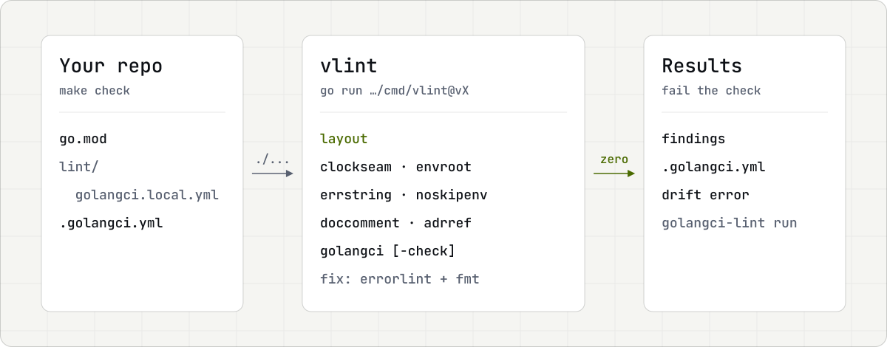

<p align="center">
  <picture>
    <source media="(prefers-color-scheme: dark)" srcset="docs/assets/banner-hero-dark.svg">
    
  </picture>
</p>

<p align="center">
  <a href="LICENSE"></a>
  <a href="go.mod"></a>
</p>

<p align="center">
  <b><a href="#quick-start">Quick start</a></b> &nbsp;·&nbsp;
  <b><a href="#usage">Rules</a></b> &nbsp;·&nbsp;
  <a href="#how-it-works">How it works</a> &nbsp;·&nbsp;
  <a href="#the-folder-layout">Layout</a> &nbsp;·&nbsp;
  <a href="#configuration">Configuration</a> &nbsp;·&nbsp;
  <a href="#development-and-tests">Development</a>
</p>

One lint kit for Go repositories that follow the Versatile engineering standard: a generated golangci-lint config, a drift check for it, and seven analyzers for what stock linters cannot see.

<a id="what-it-is"></a>

<picture>
  <source media="(prefers-color-scheme: dark)" srcset="docs/assets/section-what-it-is-dark.svg">
  
</picture>

go-lint is a versioned Go module with one command, `vlint`. A repository runs it with `go run` at a pinned version, so nothing is added to its `go.mod` and every machine runs the same rules.

| It does | It does not |
| --- | --- |
| Write the repository's `.golangci.yml` from one shared config plus a small overlay | Replace golangci-lint: it generates its config and runs beside it |
| Fail the check when the committed config drifts from the generated one | Let a repository enable extra linters or loosen shared settings |
| Run seven `go/analysis` analyzers (layout, clock, environment, errors, tests, comments, design-record references) | Apply risky autofixes: only `errorlint` and the formatters |

<a id="how-it-works"></a>

<picture>
  <source media="(prefers-color-scheme: dark)" srcset="docs/assets/section-how-it-works-dark.svg">
  
</picture>

<picture>
  <source media="(prefers-color-scheme: dark)" srcset="docs/assets/diagram-flow-dark.svg">
  
</picture>

1. The repository's `make check` calls `vlint` with `go run github.com/versatile-sh/go-lint/cmd/vlint@<version>`.
2. `vlint golangci -check` regenerates the config in memory and fails when `.golangci.yml` differs.
3. `vlint ./...` runs the analyzers over every package, test files included where a rule covers them.
4. `golangci-lint run ./...` runs the stock linters with the generated config.

<a id="quick-start"></a>

<picture>
  <source media="(prefers-color-scheme: dark)" srcset="docs/assets/section-quick-start-dark.svg">
  
</picture>

From the root of a Go module, with Go 1.27 and golangci-lint 2.15:

```sh
go run github.com/versatile-sh/go-lint/cmd/vlint@v0.2.0 golangci
go run github.com/versatile-sh/go-lint/cmd/vlint@v0.2.0 ./...
golangci-lint run ./...
```

The first line writes `.golangci.yml`. The second prints one line per finding as `file:line:col: message` and exits non-zero when there is any. Wire both into the check command:

```make
VLINT := go run github.com/versatile-sh/go-lint/cmd/vlint@v0.2.0

check:
	$(VLINT) golangci -check
	$(VLINT) ./...
	golangci-lint run ./...
```

<a id="usage"></a>

<picture>
  <source media="(prefers-color-scheme: dark)" srcset="docs/assets/section-usage-dark.svg">
  
</picture>

| Analyzer | Reports | Fix |
| --- | --- | --- |
| `layout` | A folder outside the layout below, or an import that points against the layers | Move the package; invert the dependency through a port |
| `clockseam` | `time.Now`, `time.Since`, `time.Until` (calls or function values) outside the composition root | Inject a clock port; the real clock lives in `app/` or a clock package, whose folder or name starts or ends with `clock` (`clock`, `clockwork`, `worldclock`), a module root included |
| `envroot` | `os.Getenv`, `os.LookupEnv`, `os.Environ` outside the composition root | Read configuration once in `app/` and pass values in |
| `errstring` | `err.Error()` compared with `==`, `!=`, `switch` or a `strings` matcher, outside tests | A sentinel with `errors.Is`, or a typed error with `errors.As` |
| `noskipenv` | A test that skips silently: any `Skip` not guarded by `testing.Short()`, an opt-out variable or a platform check | `t.Fatal` when the environment is missing; skip only under `testing.Short()`, an opt-out variable whose name has a `SKIP` token (`STORE_SKIP_INTEGRATION=1`), or `runtime.GOOS`/`GOARCH` |
| `doccomment` | An exported symbol without a doc comment, a doc comment over two lines, a doc comment on an unexported symbol, and any other comment | Name things so the code reads without comments; keep two lines on exported symbols |
| `adrref` | A design-record id (`ADR-12`) or a record folder path (`docs/adr/`) in a Go comment or string literal, or in a `.proto` comment | State the behaviour; keep records outside the repository; fix `.proto` sources, then regenerate |

Exempt from `clockseam` and `envroot`: `main` packages, `app/` and `cmd/`, `_test.go` files, and test-kit packages whose name ends in `test`. `doccomment` allows directives (`//go:`, `//nolint:`, build tags), example `// Output:` blocks, generated files, comments above the `package` clause, and two-line doc comments on struct fields and interface methods. `noskipenv` exempts the re-exec idiom, a test function named `*HelperProcess`. `adrref` skips generated Go files (a `Code generated ... DO NOT EDIT.` header, such as `.pb.go`) and instead reads every `.proto` file of each analyzed module, skipping `testdata/`, `vendor/`, `node_modules/`, dot and underscore folders and nested modules.

Run only some analyzers with their flags, for example `vlint -layout -errstring ./...`, or all but one with `-clockseam=false`. `vlint help` lists them. Files behind a build tag are analyzed only when the tag is set: `vlint -tags integration ./...` (comma-separated, passed to package loading). `vlint` exits 3 on findings and 1 when a package fails to load or type-check.

Apply the safe fixes only:

```sh
go run github.com/versatile-sh/go-lint/cmd/vlint@v0.2.0 fix ./...
```

It runs `golangci-lint run --fix --enable-only errorlint` and then `golangci-lint fmt` (gofmt and goimports). Turning `%v` into `%w` makes wrapped errors visible to `errors.Is`, so run the tests afterwards.

<a id="the-dont-get-worse-gate"></a>**The "don't get worse" gate.** A repository that cannot reach zero findings in one change commits a baseline and fails only on new findings:

```sh
vlint -baseline lint/vlint-baseline.txt -write ./...   # record today's findings
vlint -baseline lint/vlint-baseline.txt ./...          # in make check
```

Each baseline line is the module-relative file, the analyzer, a hash of the reported source line (whitespace collapsed) and the message. There is no line number, so edits elsewhere in a file do not disturb it; editing the reported line itself makes its finding new, which asks for the fix. Repeated identical lines count one finding each. The check prints `N new findings`, exits 3 when N > 0, and lists the entries that no longer occur as `fixed:` without failing; rerun with `-write` to shrink the file. Use the same flags (`-tags`, analyzer flags) when writing and checking. A package that fails to load fails the run, so a broken tree never passes as clean.

For golangci-lint, set a merge base in the overlay and regenerate; golangci-lint then reports only issues on lines changed since that ref:

```yaml
issues:
  new-from-merge-base: origin/main
```

This gate is diff-based, not key-based: it needs the git history and the ref present locally (fetch `origin/main` in a shallow CI clone), and it checks nothing on the base branch itself. Run the full `golangci-lint run` when you want the whole debt.

<a id="the-folder-layout"></a>**The folder layout.** Paths are relative to the Go module root.

| Folder | Role | May import from the module |
| --- | --- | --- |
| `app/` | The composition root: configuration, wiring, the real clock | Anything. Only `cmd/` and `main` packages import it |
| `cmd/<binary>/` | Thin mains and generators | Anything. Nothing imports it |
| `port/` | The contract: interfaces, the plain types they speak, sentinel errors, the coded error type | `port/`, `schema/`, `api/` |
| `core/` | Pure domain rules, no I/O | `core/`, `port/`, `schema/` |
| `service/` | Operations over core and ports; knows no transport | Anything but `app/` and `cmd/` |
| `schema/`, `api/` | Contract data and generated types | Their own subtree (`api/` may use `schema/`) |
| Flat adapter folders (`store/`, `server/`, one per driver) and `internal/<helper>/` | Adapters and module-private helpers | Anything but `app/` and `cmd/` |

Test files may import anything except `cmd/`. These folder names are reported wherever they appear at the root or under `internal/`: `domain`, `ports`, `application`, `adapters`, `adapter`, `bootstrap`, `infrastructure`, `infra`, `usecase`, `usecases`, `pkg`, `util`, `utils`, `common`, `helpers`, `shared`, `lib`. Layer folders sit at the module root, not under `internal/`. Finer edges between adapters belong to the repository's own dependency table.

<a id="configuration"></a>

<picture>
  <source media="(prefers-color-scheme: dark)" srcset="docs/assets/section-configuration-dark.svg">
  
</picture>

A repository adds rules in `lint/golangci.local.yml`, then runs `vlint golangci` to regenerate. The overlay accepts three keys only, `exclusions`, `depguard` and `issues.new-from-merge-base` (see the gate above):

```yaml
exclusions:
  rules:
    - path: 'legacy/'
      linters: [gosec]
depguard:
  rules:
    core-no-sql:
      files: ["**/core/**"]
      deny:
        - pkg: database/sql
          desc: core does no I/O
```

Any other key is refused, and a depguard rule may not reuse a shared rule's name. The shared config leaves `sloglint` autofix unused, and `nilnil` checks pointers, functions and channels only, so `(nil, nil)` from gRPC metadata stubs and `any` results is not reported.

<a id="development-and-tests"></a>

<picture>
  <source media="(prefers-color-scheme: dark)" srcset="docs/assets/section-development-and-tests-dark.svg">
  
</picture>

```sh
make check   # gofmt, go vet, config drift, vlint on itself, golangci-lint
make test    # go test -race -count=1 ./...
make images  # regenerate the README images in docs/assets
```

Each analyzer has `analysistest` cases in `passes/<analyzer>/testdata`: every rule has a case that must be reported and a case that must not. The README images are generated by `docs/assets/src/build-banners.mjs` from `docs/assets/src/readme.assets.json`; never edit an SVG by hand.

<a id="security-notes"></a>

<picture>
  <source media="(prefers-color-scheme: dark)" srcset="docs/assets/section-security-notes-dark.svg">
  
</picture>

go-lint reads source files and `go.mod` files and writes only `.golangci.yml`. `vlint fix` runs the `golangci-lint` binary found on `PATH`. Report a vulnerability through a private GitHub security advisory on this repository, not a public issue.

<a id="contributing"></a>

<picture>
  <source media="(prefers-color-scheme: dark)" srcset="docs/assets/section-contributing-dark.svg">
  
</picture>

Open an issue or a pull request. A new rule comes with its analyzer, its `analysistest` cases and a row in the table above, and `make check` and `make test` pass.

<a id="license"></a>

<picture>
  <source media="(prefers-color-scheme: dark)" srcset="docs/assets/section-license-dark.svg">
  
</picture>

Copyright (C) 2026 Versatile (versatile.sh)

go-lint is free software: you can redistribute it and/or modify it under the terms of the GNU General Public License as published by the Free Software Foundation, either version 3 of the License, or (at your option) any later version. See [LICENSE](LICENSE).

For a commercial licence without the GPL's obligations, contact Versatile through [versatile.sh/contact](https://versatile.sh/contact).

Contributions are accepted under the CLA, see [CONTRIBUTING.md](CONTRIBUTING.md).
