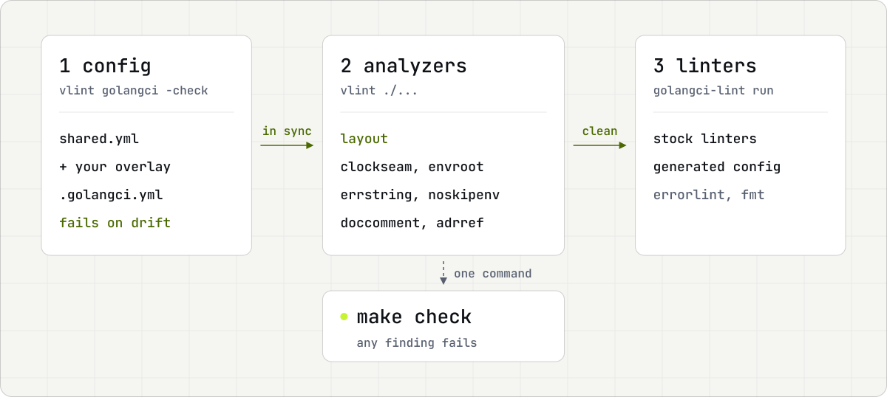
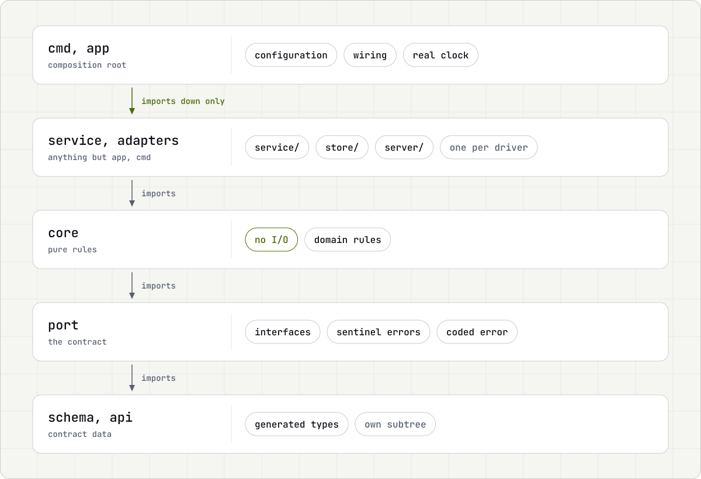

<p align="center">
  <picture>
    <source media="(prefers-color-scheme: dark)" srcset="docs/assets/banner-hero-dark.svg">
    
  </picture>
</p>

<p align="center">
  <a href="LICENSE"></a>
  <a href="go.mod"></a>
</p>

<p align="center">
  <b><a href="#quick-start">Quick start</a></b> &nbsp;·&nbsp;
  <b><a href="#usage">Rules</a></b> &nbsp;·&nbsp;
  <a href="#how-it-works">How it works</a> &nbsp;·&nbsp;
  <a href="#the-folder-layout">Layout</a> &nbsp;·&nbsp;
  <a href="#configuration">Configuration</a> &nbsp;·&nbsp;
  <a href="#development-and-tests">Development</a>
</p>

One lint kit for Go repositories that follow the Versatile engineering standard: a generated golangci-lint config, a drift check for it, and seven analyzers for what stock linters cannot see.

<a id="what-it-is"></a>

<picture>
  <source media="(prefers-color-scheme: dark)" srcset="docs/assets/section-what-it-is-dark.svg">
  
</picture>

go-lint is a versioned Go module with one command, `vlint`. A repository pins it in `mise.toml` (or runs it with `go run` at a pinned version), so nothing is added to its `go.mod` and every machine runs the same rules.

| It does | It does not |
| --- | --- |
| Write the repository's `.golangci.yml`, its lighter `.golangci-fast.yml` and its `.revive.toml` from one shared config plus a small overlay | Replace golangci-lint: it generates its config and runs beside it |
| Run the linters in three tiers (fast on staged files, changed since the merge base, full), so the daily loop stays under seconds | Let a repository enable extra linters or loosen shared settings |
| Run seven `go/analysis` analyzers (layout, clock, environment, errors, tests, comments, design-record references) | Apply risky autofixes: only `errorlint` and the formatters |

<a id="how-it-works"></a>

<picture>
  <source media="(prefers-color-scheme: dark)" srcset="docs/assets/section-how-it-works-dark.svg">
  
</picture>

<picture>
  <source media="(prefers-color-scheme: dark)" srcset="docs/assets/diagram-gate-dark.svg">
  
</picture>

<picture>
  <source media="(prefers-color-scheme: dark)" srcset="docs/assets/diagram-layout-dark.svg">
  
</picture>

1. The repository's `mise run check` calls `vlint`, pinned in its `mise.toml`.
2. `vlint golangci -check` regenerates the three config files in memory and fails when one differs from the committed file.
3. `vlint ./...` runs the analyzers over every package, test files included where a rule covers them.
4. `golangci-lint run ./...` runs the stock linters with the generated config.

That is the **full** tier. Two lighter tiers run in the git hooks: `vlint fast` on commit and `vlint changed` on push (see "The three tiers" below).

<a id="quick-start"></a>

<picture>
  <source media="(prefers-color-scheme: dark)" srcset="docs/assets/section-quick-start-dark.svg">
  
</picture>

From the root of a Go module, with Go 1.27, golangci-lint 2.15 and revive 1.17:

```sh
vlint golangci          # writes .golangci.yml, .golangci-fast.yml and .revive.toml
vlint golangci -out .config/lint   # same, in a folder; the overlay is read there as golangci.local.yml
vlint ./...             # full tier: the analyzers on every package
golangci-lint run ./... # full tier: the stock linters
```

The first line writes the three generated configs. The second prints one line per finding as `file:line:col: message` and exits non-zero when there is any. Pin the tools and wire the tiers in `mise.toml`:

```toml
[tools]
go = "1.27.3"
"go:github.com/versatile-sh/go-lint/cmd/vlint" = "0.3.0"
"go:github.com/golangci/golangci-lint/v2/cmd/golangci-lint" = "2.15.0"
"go:github.com/mgechev/revive" = "1.17.1"

[tasks.lint-fast]
run = "vlint fast -fix"

[tasks.lint]
run = ["vlint golangci -check", "vlint changed"]

[tasks.lint-full]
run = ["vlint golangci -check", "vlint ./...", "golangci-lint run ./..."]

[tasks.check]
run = [{ task = "lint-full" }, { task = "test" }]
```

With lefthook, `pre-commit` runs `mise run lint-fast {staged_files}` and `pre-push` runs `mise run lint`.

<a id="usage"></a>

<picture>
  <source media="(prefers-color-scheme: dark)" srcset="docs/assets/section-usage-dark.svg">
  
</picture>

| Analyzer | Reports | Fix |
| --- | --- | --- |
| `layout` | A folder outside the layout below, or an import that points against the layers | Move the package; invert the dependency through a port |
| `clockseam` | `time.Now`, `time.Since`, `time.Until` (calls or function values) outside the composition root | Inject a clock port; the real clock lives in `app/` or a clock package, whose folder or name starts or ends with `clock` (`clock`, `clockwork`, `worldclock`), a module root included |
| `envroot` | `os.Getenv`, `os.LookupEnv`, `os.Environ` outside the composition root | Read configuration once in `app/` and pass values in |
| `errstring` | `err.Error()` compared with `==`, `!=`, `switch` or a `strings` matcher, outside tests | A sentinel with `errors.Is`, or a typed error with `errors.As` |
| `noskipenv` | A test that skips silently: any `Skip` not guarded by `testing.Short()`, an opt-out variable or a platform check | `t.Fatal` when the environment is missing; skip only under `testing.Short()`, an opt-out variable whose name has a `SKIP` token (`STORE_SKIP_INTEGRATION=1`), or `runtime.GOOS`/`GOARCH` |
| `doccomment` | An exported symbol without a doc comment, a doc comment over two lines, a doc comment on an unexported symbol, and any other comment | Name things so the code reads without comments; keep two lines on exported symbols |
| `adrref` | A design-record id (`ADR-12`) or a record folder path (`docs/adr/`) in a Go comment or string literal, or in a `.proto` comment | State the behaviour; keep records outside the repository; fix `.proto` sources, then regenerate |

Exempt from `clockseam` and `envroot`: `main` packages, `app/` and `cmd/`, `_test.go` files, and test-kit packages whose name ends in `test`. `doccomment` allows directives (`//go:`, `//nolint:`, build tags), example `// Output:` blocks, generated files, comments above the `package` clause, and two-line doc comments on struct fields and interface methods. `noskipenv` exempts the re-exec idiom, a test function named `*HelperProcess`. `adrref` skips generated Go files (a `Code generated ... DO NOT EDIT.` header, such as `.pb.go`) and instead reads every `.proto` file of each analyzed module, skipping `testdata/`, `vendor/`, `node_modules/`, dot and underscore folders and nested modules.

<a id="the-three-tiers"></a>**The three tiers.** The heavy linters and a whole-repository run are too slow for every commit, so the same rules run at three depths:

| Tier | When | Command | What it runs |
| --- | --- | --- | --- |
| fast | `pre-commit` | `vlint fast [-fix] <files>` | goimports formatting of the staged files, then `revive` (AST only, no type check) on their packages with `.revive.toml`, reporting only findings on lines changed since `HEAD` |
| changed | `pre-push` | `vlint changed [-base origin/main] [-tags t] [-baseline f]` | `vlint` analyzers and `golangci-lint -c .golangci-fast.yml --new-from-merge-base <base>` on the packages changed since the merge base, per module |
| full | on demand (`mise run lint-full`, `mise run check`) | `vlint ./...` and `golangci-lint run ./...` | Everything, with `.golangci.yml` |

`vlint changed` counts committed, staged, unstaged and untracked `.go` files (skipping `testdata`, `vendor` and dot or underscore folders), maps each to its package and its nearest `go.mod`, and lints the whole module when `go.mod`, `go.sum` or a lint config changed. `-list` prints the packages and runs nothing. The `-baseline` file is read relative to the repository root and only new findings fail; `fixed:` entries are not listed, because a partial run cannot tell. The fast preset `.golangci-fast.yml` is the full config minus `gosec`, `contextcheck`, `sloglint` and `testifylint`; those four run in the full tier only. `vlint fast` finds `revive` on `PATH` and otherwise runs it through `go run` at the pinned version.

The costs, measured with `nice -n 19`, `GOMAXPROCS=4`, one run at a time on a 16-thread workstation (wall time, CPU time user+system, peak resident memory), at the current `main` of two repositories, with a one-file change:

| Measurement | platform-engine (3,051 Go files) | test-engine |
| --- | --- | --- |
| golangci-lint full, cold cache | 63.5 s wall, 199.6 s CPU, 3,718 MB | 18.5 s, 99.7 s, 902 MB |
| golangci-lint full, warm cache | 1.9 s, 4.5 s, 154 MB | 0.5 s, 1.2 s, 122 MB |
| golangci-lint `--new-from-merge-base`, 1 file, full config, fresh edit | 49.5 s, 184.9 s, 3,960 MB | not measured |
| golangci-lint fast preset + `--new-from-merge-base`, 1 package, first run | 19.8 s, 60.3 s, 3,220 MB | 3.6 s, 10.5 s, 484 MB |
| golangci-lint fast preset + `--new-from-merge-base`, 1 package, cold cache | 24.0 s, 72.8 s, 3,433 MB | 3.5 s, 10.0 s, 431 MB |
| staticcheck alone, all packages | 26.5 s, 98.0 s, 3,111 MB | 6.1 s, 22.0 s, 313 MB |
| revive alone, all packages | 0.5 s, 1.1 s, 140 MB | 0.1 s, 0.2 s, 38 MB |
| revive, 1 changed package | 0.2 s, 0.3 s, 76 MB | under 0.1 s, 24 MB |
| `go vet`, 1 changed package | 7.1 s, 31.1 s, 1,126 MB | 2.3 s, 9.7 s, 97 MB |
| vlint full (with the baseline where the repository has one) | 4.3 s, 17.7 s, 1,088 MB | 0.5 s, 1.4 s, 210 MB |
| vlint, 1 changed package | 1.0 s, 2.3 s, 270 MB | 0.2 s, 0.4 s, 54 MB |
| **`vlint fast`, 1 staged file (pre-commit)** | **0.2 s, 0.3 s, 76 MB** | **0.1 s, 0.1 s, 24 MB** |
| **`vlint changed`, fresh 1-file edit, caches warm (pre-push)** | **20.4 s, 54.1 s, 1,007 MB** | **2.9 s, 8.3 s, 274 MB** |
| `vlint changed`, same 1-file edit run again | 1.9 s, 4.1 s, 259 MB | 0.6 s, 1.2 s, 111 MB |

"Cold" is an empty golangci-lint cache with a warm Go build cache. "Fresh edit" is a new edit to a file of a package with many dependents (`internal/application`, `service`). Peak memory is the largest process of the run. Rows whose command exits non-zero did so because of findings, not failures. `/usr/bin/time` is not installed on the benchmark machine, so the figures come from `getrusage` of the child processes, the same counters `time -v` prints.

Run only some analyzers with their flags, for example `vlint -layout -errstring ./...`, or all but one with `-clockseam=false`. `vlint help` lists them. Files behind a build tag are analyzed only when the tag is set: `vlint -tags integration ./...` (comma-separated, passed to package loading). `vlint` exits 3 on findings and 1 when a package fails to load or type-check.

Apply the safe fixes only:

```sh
vlint fix ./...
```

It runs `golangci-lint run --fix --enable-only errorlint` and then `golangci-lint fmt` (gofmt and goimports). Turning `%v` into `%w` makes wrapped errors visible to `errors.Is`, so run the tests afterwards.

<a id="the-dont-get-worse-gate"></a>**The "don't get worse" gate.** A repository that cannot reach zero findings in one change commits a baseline and fails only on new findings:

```sh
vlint -baseline lint/vlint-baseline.txt -write ./...   # record today's findings
vlint -baseline lint/vlint-baseline.txt ./...          # in mise run check
```

Each baseline line is the module-relative file, the analyzer, a hash of the reported source line (whitespace collapsed) and the message. There is no line number, so edits elsewhere in a file do not disturb it; editing the reported line itself makes its finding new, which asks for the fix. Repeated identical lines count one finding each. The check prints `N new findings`, exits 3 when N > 0, and lists the entries that no longer occur as `fixed:` without failing; rerun with `-write` to shrink the file. Use the same flags (`-tags`, analyzer flags) when writing and checking. A package that fails to load fails the run, so a broken tree never passes as clean.

For golangci-lint, set a merge base in the overlay and regenerate; golangci-lint then reports only issues on lines changed since that ref:

```yaml
issues:
  new-from-merge-base: origin/main
```

This gate is diff-based, not key-based: it needs the git history and the ref present locally (fetch `origin/main` in a shallow CI clone), and it checks nothing on the base branch itself. Run the full `golangci-lint run` when you want the whole debt.

<a id="the-folder-layout"></a>**The folder layout.** Paths are relative to the Go module root.

| Folder | Role | May import from the module |
| --- | --- | --- |
| `app/` | The composition root: configuration, wiring, the real clock | Anything. Only `cmd/` and `main` packages import it |
| `cmd/<binary>/` | Thin mains and generators | Anything. Nothing imports it |
| `port/` | The contract: interfaces, the plain types they speak, sentinel errors, the coded error type | `port/`, `schema/`, `api/` |
| `core/` | Pure domain rules, no I/O | `core/`, `port/`, `schema/` |
| `service/` | Operations over core and ports; knows no transport | Anything but `app/` and `cmd/` |
| `schema/`, `api/` | Contract data and generated types | Their own subtree (`api/` may use `schema/`) |
| Flat adapter folders (`store/`, `server/`, one per driver) and `internal/<helper>/` | Adapters and module-private helpers | Anything but `app/` and `cmd/` |

Test files may import anything except `cmd/`. These folder names are reported wherever they appear at the root or under `internal/`: `domain`, `ports`, `application`, `adapters`, `adapter`, `bootstrap`, `infrastructure`, `infra`, `usecase`, `usecases`, `pkg`, `util`, `utils`, `common`, `helpers`, `shared`, `lib`. Layer folders sit at the module root, not under `internal/`. Finer edges between adapters belong to the repository's own dependency table.

<a id="configuration"></a>

<picture>
  <source media="(prefers-color-scheme: dark)" srcset="docs/assets/section-configuration-dark.svg">
  
</picture>

A repository adds rules in `lint/golangci.local.yml`, then runs `vlint golangci` to regenerate. With `-out <dir>` the files go to `<dir>` and the overlay is `<dir>/golangci.local.yml` (`vlint fast` and `vlint changed` find the configs in `.config/lint` too). The overlay accepts three keys only, `exclusions`, `depguard` and `issues.new-from-merge-base` (see the gate above):

```yaml
exclusions:
  rules:
    - path: 'legacy/'
      linters: [gosec]
depguard:
  rules:
    core-no-sql:
      files: ["**/core/**"]
      deny:
        - pkg: database/sql
          desc: core does no I/O
```

Any other key is refused, and a depguard rule may not reuse a shared rule's name. The shared config leaves `sloglint` autofix unused, and `nilnil` checks pointers, functions and channels only, so `(nil, nil)` from gRPC metadata stubs and `any` results is not reported.

<a id="development-and-tests"></a>

<picture>
  <source media="(prefers-color-scheme: dark)" srcset="docs/assets/section-development-and-tests-dark.svg">
  
</picture>

```sh
mise run check   # gofmt, go vet, config drift, vlint on itself, golangci-lint, Semgrep
mise run test    # go test -race -count=1 ./...
mise run images  # regenerate the README images in docs/assets
mise run lint    # the changed tier, as the pre-push hook runs it
```

Each analyzer has `analysistest` cases in `passes/<analyzer>/testdata`: every rule has a case that must be reported and a case that must not. The README images are generated by `docs/assets/src/build-banners.mjs` from `docs/assets/src/readme.assets.json`; never edit an SVG by hand.

<a id="security-notes"></a>

<picture>
  <source media="(prefers-color-scheme: dark)" srcset="docs/assets/section-security-notes-dark.svg">
  
</picture>

go-lint reads source files, `go.mod` files and git history, and writes only `.golangci.yml`, `.golangci-fast.yml`, `.revive.toml` and, with `vlint fast -fix`, the files it formats. `vlint fix` and `vlint changed` run the `golangci-lint` binary found on `PATH`, `vlint fast` runs `revive` and `git`. Report a vulnerability through a private GitHub security advisory on this repository, not a public issue.

<a id="contributing"></a>

<picture>
  <source media="(prefers-color-scheme: dark)" srcset="docs/assets/section-contributing-dark.svg">
  
</picture>

Open an issue or a pull request. A new rule comes with its analyzer, its `analysistest` cases and a row in the table above, and `mise run check` and `mise run test` pass.

<a id="license"></a>

<picture>
  <source media="(prefers-color-scheme: dark)" srcset="docs/assets/section-license-dark.svg">
  
</picture>

Copyright (c) 2026 Versatile (versatile.sh)

go-lint is released under the [MIT License](LICENSE). Contributions are accepted under the same licence, see [CONTRIBUTING.md](CONTRIBUTING.md).
